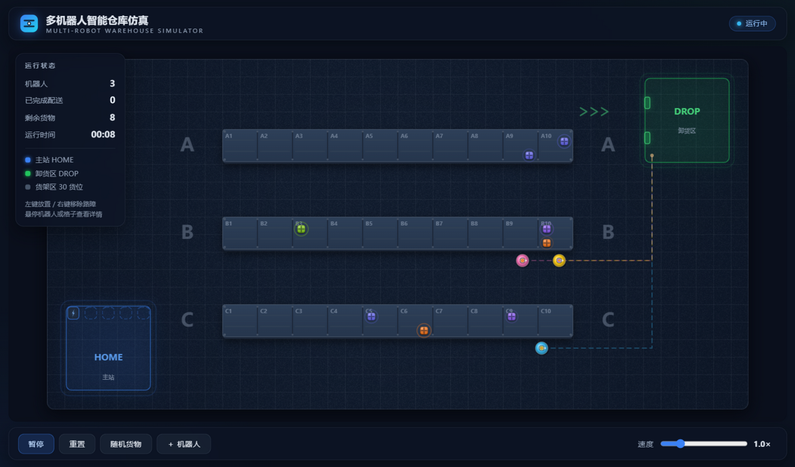
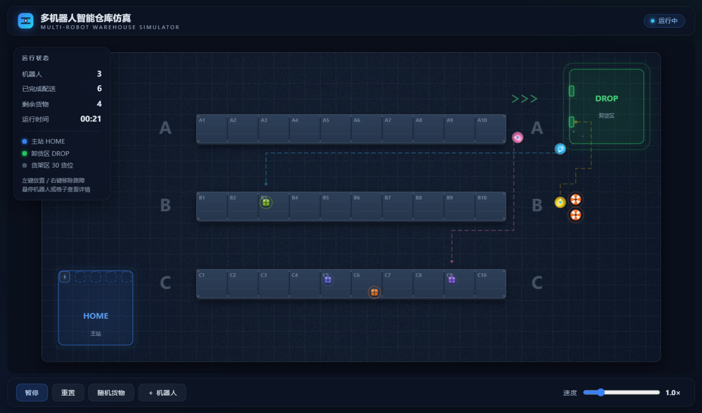
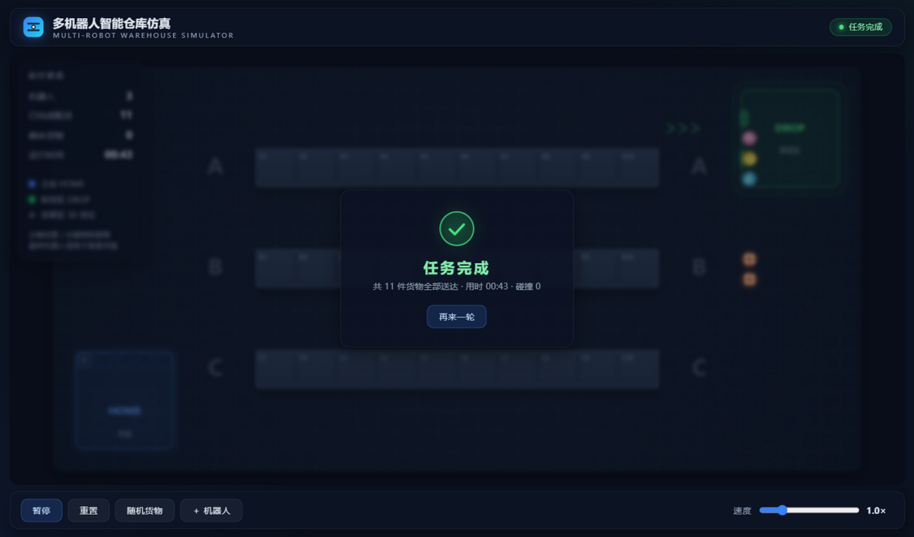

# 🤖 多机器人智能仓库仿真

**Multi-Robot Warehouse Simulator**

纯前端 2D 俯视多机器人仓库仿真 · HTML5 Canvas 2D · 零依赖 · 双击即跑

[预览](#-预览) · [功能特性](#-功能特性) · [快速开始](#-快速开始) · [技术亮点](#-技术亮点) · [版本历程](#-版本历程)

---

## 📸 预览

| 仓库总览 | 动态障碍绕行 |
|---|---|
|  |  |

| 任务完成 |
|---|
|  |

> 深色科技仓库 · 货架伪 2.5D · 发光主站 / 卸货区 · 粒子与波纹特效 · 毛玻璃 UI

## ✨ 功能特性

- **全自动配送**：多个机器人从主站出发，自动认领最近货物（A\* 规划路径），取货后送往卸货区，循环接单直至全部送完
- **多机避让**：占用预约 + 定点迭代移动解析，车队链式前进不重叠；头对头互锁裁决、错峰让位、每帧碰撞守卫三层死锁解除机制
- **动态障碍**：左键点击 / 拖动放置警示路障，右键移除；机器人路径被阻断后立即重规划绕行，被围困时自动撤离
- **随机货物**：8~12 件货物随机分布在 30 个货架货位上，包装色随机；机器人到货架旁拣货位取货（Kiva 式仓储）
- **完整控制**：暂停 / 重置 / 随机货物 / 增加机器人（最多 8 台）/ 速度调节（0.5×~3×）
- **精致视觉**：环氧地坪纹理、货位编号、粒子波纹、状态灯呼吸、托盘货物弹入、任务完成浮层
- **高 DPI**：devicePixelRatio 适配 + 静态层缓存，窗口缩放不模糊

## 🚀 快速开始

无需安装任何东西——**直接双击 `index.html`** 用现代浏览器（Chrome / Edge / Firefox）打开即可。

## 🎮 操作说明

| 操作 | 效果 |
|---|---|
| 左键点击 / 拖动空格 | 放置警示路障（机器人立即绕行） |
| 右键点击 / 拖动路障 | 移除路障 |
| 悬停机器人 | 显示状态 / 载货 / 目标 |
| 悬停格子 | 显示坐标 / 类型 / 可通行性 |
| 底部控制栏 | 暂停、重置、随机货物、＋机器人、速度滑块 |

## 🔧 技术亮点

- **A\* 寻路**：四方向 + 曼哈顿启发 + 二叉堆开放列表，全图路径约 0.05ms
- **多智能体协调**（借鉴 [warehouse-swarm](https://github.com/yusenthebot/warehouse-swarm) 与 [forklift](https://github.com/Stxqq/forklift) 的思路）：
  事件驱动版定点迭代解析器（决策轮按 id 顺序，前序释放的格子同帧可用）；
  三层死锁解除——头对头低 id 优先裁决、blocked 计时按 id 错峰让位（`6 + id%4`）、每帧碰撞守卫断言
- **双层渲染**：地板 / 货架 / 主站 / 卸货区预渲染到离屏 Canvas，每帧仅一次 drawImage + 动态元素叠加；60fps 满负载（8 机器人 + 200 粒子）帧耗时 < 0.5ms
- **逻辑与渲染分离**：格间逻辑移动 + 渲染线性插值 + 平滑转向；粒子跟随仿真时钟（暂停即冻结）

## 📦 版本历程

| 版本 | 内容 |
|---|---|
| v0.1.0 | 静态仓库场景（地板纹理 / 货架 / 主站 / 卸货区 / 高 DPI） |
| v0.2.0 | 单机器人取送货（A\* + 状态机 + 平滑移动） |
| v0.3.0 | 多机器人避让与死锁解除，货物移入货架 |
| v0.4.0 | 动态障碍与重规划（放置 / 移除 / 宽限撤离） |
| v0.5.0 | 随机货物与控制面板（tooltip / 完成浮层） |
| v0.6.0 | 视觉打磨（粒子 / 波纹 / 呼吸动效） |
| v0.7.0 | 性能与响应式（40×20 地图、重建防抖、多档断点） |
| v1.0.0 | 最终验收（十条标准全量走查通过） |

完整变更记录见 [CHANGELOG.md](CHANGELOG.md)。

## 👤 贡献者

**[@lyh355016875-ui](https://github.com/lyh355016875-ui)** — 项目作者 · 设计与开发

---

⭐ 觉得有趣就点个 Star 吧

